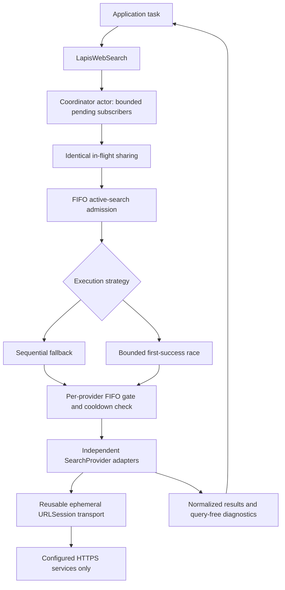

# Architecture

Swift 6 discovery-only library, with no Lapis/AI/UI dependencies. Foundation, native JSON/XML and a minimal fixed-tool MCP adapter are the only runtime building blocks.

## Contracts and compatibility

`LapisWebSearch` is a Sendable value retaining a `SearchCoordinator` actor; copies share admission/sharing/cooldown state. Separately constructed clients are isolated. `search(_:limit:)` retains its original source shape; advanced `search(_:options:)` returns attempts/configuration/duration. Existing `SearchProvider` conformances remain valid: identifier, defaultable capabilities and `search(SearchRequest) -> ProviderResponse`. New options/configuration arguments have defaults.

The registry remains an ordered array, at most eight nonempty unique provider identifiers. No plugin loader, AI tool registry or dynamic endpoint discovery exists. Providers are independent; a custom package can supply a Sendable conformer without changing the client. Advertise only supported capabilities. Country is distinct from language/locale. Unsupported filters fail rather than being silently dropped.

`SearchRequest` validates/normalizes input before networking. `SearchResult` validates absolute HTTP(S) URLs, nonempty title/provider and positive original positions; it is Encodable but not synthesized-Decodable, preserving initializer invariants. Missing dates stay nil. Parallel carries explicitly provided publication dates, with day precision at UTC midnight; Bing raw RSS dates remain metadata because their semantics differ.

## Owned concurrency

The coordinator owns a bounded table of in-flight jobs and subscriber continuations. A job is an explicit owned Task because shared work can outlive its initiating caller; it is removed on completion or final-subscriber cancellation. Every subscriber is counted against the pending limit, including coalesced callers. No finished response is cached. Keys include the normalized query and every SearchOptions field, preventing different limits/locales/filters/deadlines/strategies from sharing.

A subscriber cancellation resumes that caller promptly, removes only its continuation and cancels upstream if nobody remains. It may precede completed attempt diagnostics. First-success race children use structured task groups; native losers are cancelled, drained and included in provider-priority order in diagnostics. Custom providers must cooperate with cancellation: structured concurrency cannot preempt an uncooperative child.

FIFO actor gates bound active searches and requests per provider. Admission waiters are cancellation-aware and use monotonic deadline timers; expired/cancelled waiters do not consume or leak permits. Defaults are four active searches, one request per provider and 64 pending subscribers; explicit configurations are validated and bounded. Higher provider concurrency is a caller decision subject to permitted service capacity. Global and per-provider state are per client, not process-global.

Overall deadlines start at initial job registration, including both queues and fallback. An optional provider budget starts only after admission and is bounded by the remaining overall time. Built-in adapters receive that reduced timeout. Rate limits are checked before and again after admission so queued requests cannot bypass a 429 received while waiting. A coalesced later caller uses an already-running job's earlier deadline, never prolonging it.

## Strategy and failures

Sequential fallback stops at the first usable nonempty set; no top-up, pagination or same-provider retry. Explicit `.noResults` differs from empty/malformed `.results`. All explicit-empty providers yield `noResults`; mixed failures yield `allProvidersUnavailable`, retaining attempts. Overall expiration is `timeout`. `providerBusy` is retained for a full pending-subscriber limit, replacing the old busy-provider refusal.

First-success is opt-in, requires fallback enabled and starts at most the configured provider width (default two, maximum four). Failed attempts admit the next configured provider; a usable winner cancels the rest. It preserves provider ranking, does not merge responses and is not relevance fusion. Race calls can disclose to/bill multiple services even when cancelled. No parallel result-quality claim is implicit.

HTTP 429/402 establishes a local cooldown of at least 60 seconds and at least a valid future Retry-After. Skipped calls do not extend cooldown. No retries, proxy rotations, credential rotations or fabricated fallback data exist. Native HTTP/network/body/parser errors are classified without server text or raw URLSession descriptions.

## Transport and parsing

A transport owns one ephemeral URLSession; copies share that connection pool. It disables cookies, credential storage and URL cache and rejects all redirects. Independent tasks use a per-task URLSessionDataDelegate with bounded Data chunks. Mutable receiver state and exactly-once continuation completion are lock-protected, with callbacks/resumption outside the lock. Cancellation and whole-request timers cancel individual tasks; releasing the final session owner invalidates its session. A strong lifetime guarantee keeps storage alive through each awaited send.

Successful bodies are bounded to 2 MiB, both against declared length and incrementally for decoded chunks; error bodies are not accumulated. This is an application payload limit, not a guarantee about Foundation/OS resident memory. TLS uses system trust. Adapters revalidate body bounds and MIME types even for injected transports. No result URL is fetched.

Firecrawl encodes only standard web search controls. Parallel's fixed HTTPS MCP connection performs initialization plus notification once, retains protocol session state in memory and calls only `web_search` with the supplied query in objective/search fields. No tool discovery, external icons/resources, model metadata, arbitrary tools, fetch/research/decisions or OAuth endpoint is invoked. Responses require matching JSON-RPC IDs, accepted protocol, valid JSON/SSE and structured result content. A lost session fails that search without retry; the next search can reinitialize. Anonymous unsupported overrides are never sent.

RSS remains UTF-8 XMLParser with NUL/DTD/entity rejection, external resolution disabled, and bounded nesting/items/fields. Structured decoders never parse HTML with regular expressions. Result text is untrusted.

## Normalization and diagnostics

Normalization handles scheme/host case, default ports and empty root paths. It preserves path case, fragments, query ordering and tracking parameters, because changes can change resource identity. Deduplication is a single-pass URL set before limiting, preserving source positions. Whitespace is collapsed without stripping international text. Semantic URL aliases and domain diversity remain future evaluation questions.

Attempts include wall timestamps, monotonic total duration, queue duration, status, valid count, classification, skip/fallback and Retry-After. Response duration includes client admission; coalesced responses describe the shared job and mark `wasCoalesced`. Configuration diagnostics contain only options/provider identifiers. No raw queries, headers, MCP session IDs, server bodies or telemetry are logged by the library.
