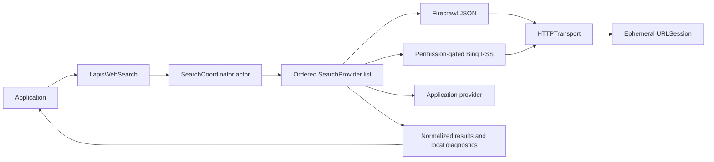

# Architecture

The package has a single discovery responsibility: turn an explicitly supplied query into normalized web search results. It is independent of Lapis, Apple Foundation Models, MLX, UI frameworks and context retrieval systems.

## Public contract

`LapisWebSearch` is a Sendable value retaining a coordinator actor. Copies share the actor's cooldown and busy state. Independently initialized clients share no state. `search(_:limit:)` returns results; `search(_:options:)` returns results and diagnostics. Failures throw `SearchError` with attempt records. Immutable `SearchRequest` validates inputs before networking. `SearchOptions` is an immutable configuration snapshot.

`SearchProvider: Sendable` declares an identifier, capabilities and one asynchronous search operation. Responses explicitly distinguish `.results` from `.noResults`. Empty `.results` is a provider failure, never a successful search. Only a structurally valid provider-declared empty response becomes `.noResults`. No provider depends on another. The ordered array is the registry; identifiers must be nonempty, unique, and number at most eight.

`SearchResult` validates an absolute HTTP(S) URL, nonempty title/provider and a positive original position at initialization. Its fields are immutable. It is Encodable rather than Decodable, so synthesized decoding cannot bypass those invariants. Dates and metadata are optional and are never synthesized from inference. Empty snippets are permitted when the provider omits them.

## Lifecycle and ordering

The coordinator validates registry configuration and creates a monotonic overall deadline. It attempts providers sequentially, skipping busy providers, active rate-limit cooldowns and unsupported settings. A successful nonempty list is deduplicated by normalized URL, limited and returned immediately. No extra provider requests are issued to fill a short list. An explicit no-results response can fall back. If every response is explicit no-results, the aggregate code is `noResults`; mixed failures become `allProvidersUnavailable`. All prior attempt errors remain visible.

URLs normalize scheme/host case, default ports and an empty root path. Path case, query parameter order, fragments and tracking parameters remain intact because rewriting them can change resource identity. HTTP and HTTPS remain distinct. Titles and snippets collapse whitespace and preserve international text. Providers retain their result ordering and original one-based positions. There is no ranking engine or arbitrary domain diversity penalty.

## Deadlines, cancellation and state

A structured throwing task group races each operation against the same overall deadline and cancels its sibling on completion. Native URLSession and the built-in providers cooperate with task cancellation. A custom provider must also cooperate; Swift structured concurrency waits for children to finish, so an uncooperative custom implementation cannot be forcibly terminated by this library. Public cancellation is classified as `SearchError.cancelled` and prevents fallback.

The actor may reenter while networking. A per-provider busy set prevents overlapping calls through the same coordinator; another search skips busy providers instead of waiting or multiplying traffic. Busy state is cleared on success, error and cancellation. There is no global mutable state or query cache. Each search's results and attempt list remain local to that invocation.

HTTP 429 and 402 establish a per-provider cooldown lasting at least 60 seconds and no less than a valid future Retry-After date. Missing/malformed Retry-After uses the conservative minimum. Skipped requests do not extend cooldowns. There are no automatic retries, token rotations or anti-bot workarounds.

## Networking and parsing

Built-in adapters use fixed HTTPS endpoints. The default transport creates an ephemeral session per operation, with cookies, credential storage and URL cache disabled. Redirects are rejected, including same-host redirects: a redirect is an invalid response rather than an implicit new destination. TLS uses system trust validation. Non-success response bodies are not read into diagnostics. A 2 MiB decompressed payload bound is checked before allocation when Content-Length is available and incrementally while reading. Adapters recheck size and content type even for injected transports.

Firecrawl uses JSONEncoder/JSONDecoder, requests only standard web results, and ignores extra fields. Invalid rows are discarded; all-invalid rows fail. RSS uses XMLParser after UTF-8 validation and DTD/entity rejection, disables external resolution and bounds nesting, items and field sizes. HTML is never scraped or parsed with regex. Returned text is untrusted data.

## Extending

Implement `SearchProvider`, advertise only supported capabilities, keep networking destinations explicit, return genuine zero-result states, and throw structured failures. An application may inject `HTTPTransport`, taking responsibility for its cancellation, destination, redirect and resource policies. Add offline request/fixture/error tests and a separately authorized live evaluation before enabling a new provider. No change to `LapisWebSearch` is required.
